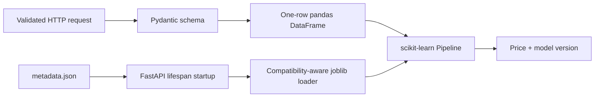
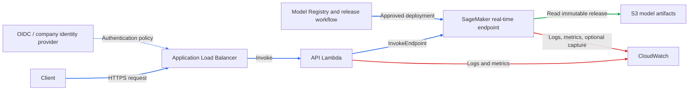

# Vehicle Price Estimation API

Production-oriented inference API that serves the supplied vehicle price model over a small HTTP contract. Every response reports the model version that produced it.

**Contents:** [Scope](#scope) · [Quick start](#quick-start) · [API contract](#api-contract) · [Inference flow](#inference-flow) · [Architecture](#architecture) · [Design decisions](#design-decisions) · [Configuration](#configuration) · [Quality checks](#quality-checks) · [Repository layout](#repository-layout) · [Known limitations](#known-limitations) · [Next steps](#next-steps) · [Further documentation](#further-documentation)

## Scope

| In scope                                        | Out of scope |
|-------------------------------------------------| --- |
| `POST /predict`, `GET /health`                  | Model training, automated retraining, model monitoring |
| Strict validation of the four model features    | Authentication (shown in the AWS proposal only) |
| One model load per worker                       | AWS infrastructure deployment |
| Unit and integration tests on the real artifact | |
| Docker and locked dependencies (Python 3.12)    | |

The training notebook is model context only; it is not required to run the API. ↑ [Contents](#vehicle-price-estimation-api)

## Quick start

**Prerequisites:** Python 3.12, [uv](https://docs.astral.sh/uv/), `make`

```bash
make install
make dev        # http://localhost:8000
```

With the server running, verify it from another terminal:

```bash
make health
make predict
```

Set `API_URL` to target another local port or environment, for example `make health API_URL=http://localhost:8080`.

| Path | Requires                                         | Commands |
| --- |--------------------------------------------------| --- |
| Local | Python 3.12, uv, make                            | `make install && make test && make dev` |
| Docker | Docker, make (network needed at build time only) | `make docker-build && make docker-run` |

For the submitted ZIP, extract it first (`unzip vehicle-price-estimation-api.zip && cd vehicle-price-estimation-api`). The archive is self-contained: source, locked dependencies, model pipeline, and metadata must stay together.

Interactive docs: [Swagger UI](http://localhost:8000/docs) · [ReDoc](http://localhost:8000/redoc) · [OpenAPI schema](http://localhost:8000/openapi.json) ↑ [Contents](#vehicle-price-estimation-api)

The version-controlled [`docs/openapi.json`](docs/openapi.json) is generated from the FastAPI application with `make openapi`; the synchronization test prevents it from drifting from the runtime contract.

## API contract

### `POST /predict`

Request body:

| Field | Type | Constraint |
| --- | --- | --- |
| `marque` | string | `audi`, `bmw`, `ford`, `tesla` |
| `date_first_circulation` | date | ISO `YYYY-MM-DD`, not in the future |
| `km` | number | `>= 0` |
| `gearbox` | string | `manual`, `auto` |

```bash
curl --fail --request POST \
  --header 'Content-Type: application/json' \
  --data '{"marque":"bmw","date_first_circulation":"2018-03-01","km":108946,"gearbox":"auto"}' \
  http://localhost:8000/predict
```

Response (the price changes over time because the pipeline derives age from the current date; the shape is stable):

```json
{ "predicted_price": 7129.82666015625, "model_version": "1.0.0" }
```

The API returns the finite, non-negative model output without applying display rounding. It does not return a currency because neither the candidate brief nor the model metadata defines one; callers must not infer EUR from this contract.

The allowed categorical values are read from `artifacts/metadata.json` at startup and enforced before inference. Basic field types, the non-negative mileage rule, the date format, and the future-date rule are enforced by the Pydantic request model.

### `GET /health`

Returns `200` once the pipeline is loaded in application state. It is a readiness check for a load balancer or orchestrator, not an end-to-end prediction test.

```bash
curl --fail http://localhost:8000/health
# {"status": "ok", "model_version": "1.0.0"}
```

### Errors

| Status | Meaning |
| --- | --- |
| `422` | Input does not satisfy the schema |
| `503` | Application is running, model is not ready |
| `500` | Prediction failed after validation (exception logged, not returned) |

↑ [Contents](#vehicle-price-estimation-api)

## Inference flow



1. FastAPI validates the request before any model code runs.
2. The `def` route runs in FastAPI's thread pool, keeping blocking CPU work off the event loop.
3. The service builds the four-column `DataFrame` the pipeline expects.
4. The preloaded pipeline performs feature transformation and prediction.
5. The finite, non-negative model result is returned unchanged with its model version.

↑ [Contents](#vehicle-price-estimation-api)

## Architecture

### Local and container

- Each Gunicorn worker loads `model_pipeline.joblib` and `metadata.json` once and holds its own copy. Choose worker count from measured CPU, memory, and latency.
- The Docker image runs Gunicorn with two Uvicorn workers on port `8000`. Artifacts are bundled, so no AWS credentials or external services are needed.

### Proposed AWS production architecture

Not deployed by this repository. Target design for the company environment:



Arrow colors: blue = request/deployment trigger, green = read, red = write.

- Authentication is enforced at the ALB/API boundary, not in model code. It is not implemented here.
- The runnable code uses in-process inference. Reaching the AWS design needs a SageMaker serving contract, an API proxy adapter, IaC, IAM policies, and production validation.

↑ [Contents](#vehicle-price-estimation-api)

## Design decisions

| Decision | Rationale |
| --- | --- |
| Load once, predict many | Deserialization happens at startup (FastAPI lifespan), not per request |
| Call the pipeline's `.predict(DataFrame)` | Preprocessing stays inside the pipeline, reducing training-serving skew |
| Validate at the HTTP boundary | The model only sees its documented input domain; callers get standard `422` errors |
| Synchronous `def` route | Pandas and scikit-learn are blocking; `async def` would block the event loop |
| Return `model_version` | Provenance; in production, an immutable release ID from the process that ran inference |

↑ [Contents](#vehicle-price-estimation-api)

## Configuration

| Variable | Default |
| --- | --- |
| `API_MODEL_PIPELINE_PATH` | `artifacts/model_pipeline.joblib` |
| `API_METADATA_PATH` | `artifacts/metadata.json` |

```bash
API_MODEL_PIPELINE_PATH=/opt/models/model.joblib \
API_METADATA_PATH=/opt/models/metadata.json \
make dev
```

↑ [Contents](#vehicle-price-estimation-api)

## Quality checks

| Command | Purpose |
| --- | --- |
| `make health` | Check whether the local API worker is ready |
| `make predict` | Send the documented sample prediction request |
| `make test` | Full test suite |
| `make lint` | Static checks and formatting verification |
| `make openapi` | Regenerate the reviewable OpenAPI contract from FastAPI |
| `make smoke-model` | Verify the serialized artifact in a clean process |
| `make smoke-zip` | Build the submission ZIP and verify it in an isolated Python 3.12 environment |
| `uv run pre-commit install` | Enable Ruff lint fixes and Ruff formatting before commits |

↑ [Contents](#vehicle-price-estimation-api)

## Repository layout

```text
.
├── src/vehicle_price/
│   ├── domain.py        # Vehicle, Prediction, Predictor protocol, domain errors
│   ├── service.py       # PredictionService use case
│   ├── adapters.py      # Domain Predictor port to scikit-learn adapter
│   ├── infrastructure.py # JSON/joblib loading and artifact compatibility
│   ├── settings.py      # Environment-backed settings
│   └── main.py          # FastAPI app factory, routes, error handlers
├── artifacts/           # metadata.json, model_pipeline.joblib (supplied)
├── scripts/smoke_model.py
├── tests/               # Unit and integration tests
├── Dockerfile · Makefile · pyproject.toml · uv.lock
```

↑ [Contents](#vehicle-price-estimation-api)

## Known limitations

- **Date-dependent output:** age is computed from the server's current date, so identical inputs can yield different prices over time. A future cache key would need an effective prediction date.
- **Future dates rejected:** a future first-registration date would produce a negative vehicle age outside the documented training domain.
- **Currency unspecified:** the supplied contract and metadata do not define a currency, so the API deliberately returns none.
- **Runtime categorical validation:** allowed brands and gearboxes come from `metadata.json`; OpenAPI exposes their fields as strings rather than a static enum.
- **Unbenchmarked defaults:** the two-worker Gunicorn setting is a runnable default, not a measured optimum.
- **Model version versus release ID:** structured JSON logs correlate requests, outcomes, durations, predictions, and the metadata model version, but the supplied artifact has no separate immutable release ID.
- **No validated targets:** latency, memory, concurrency, availability, and cost are unmeasured.
- **Shallow health check:** `/health` checks local readiness only.

↑ [Contents](#vehicle-price-estimation-api)

## Next steps

1. Define p95/p99 latency, availability, timeout, privacy, and cost objectives.
2. Benchmark cold start, warm inference, memory, CPU, and concurrency with representative traffic.
3. Package the custom transformer as a versioned, importable module and re-export the artifact.
4. Add operational metrics and define an immutable release ID distinct from the model version.
5. Add CI for linting, tests, artifact compatibility, and container vulnerability scanning.
6. Build the AWS path with CDK, least-privilege IAM, immutable image and artifact references, and rollback tests.
7. Add drift analysis only after defining reference data and an action policy. Drift should trigger investigation, not automatic promotion.
8. Evaluate batch inference separately; SageMaker Batch Transform does not replace the real-time API.
9. Consider prediction caching only after measuring exact-input reuse. Model residency is mandatory; response caching is not.

↑ [Contents](#vehicle-price-estimation-api)

## Further documentation

| Document | Content |
| --- | --- |
| [CONTRIBUTING.md](CONTRIBUTING.md) | Conventional Commits policy |

↑ [Contents](#vehicle-price-estimation-api)
