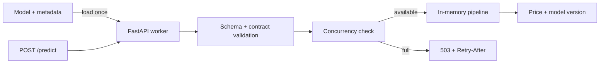
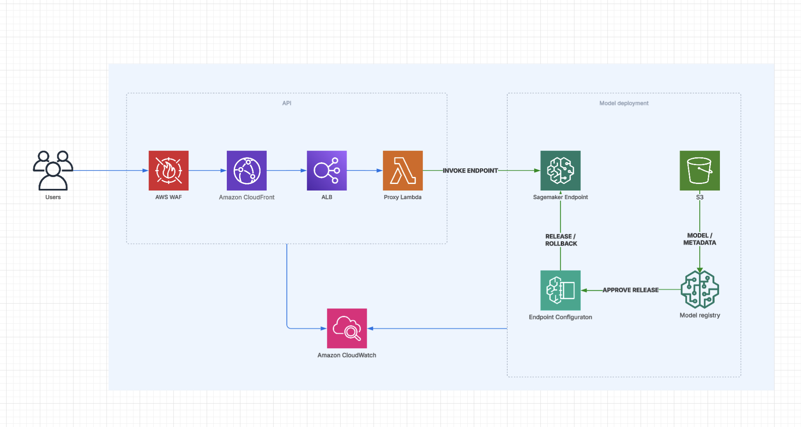

# Vehicle Price Estimation API

Production-oriented FastAPI service for the supplied scikit-learn/XGBoost pipeline. It exposes a small, validated HTTP interface and returns the model version with every prediction.

## Quick start

**Prerequisites:** Python 3.12, [uv](https://docs.astral.sh/uv/), and `make`.

```bash
make install
make test
make dev        # http://localhost:8000
```

From another terminal:

```bash
make health     # verify that the model is loaded
make predict    # send the built-in example request
```

`make predict` uses an automatic BMW first registered in 2018 with 108,946 km. Use [Swagger UI](http://localhost:8000/docs) to try other values. To target another local port or environment:

```bash
make predict API_URL=http://localhost:8080
```

Docker provides the same API without requiring a local Python environment:

```bash
make docker-build
make docker-run
```

For the submitted archive, run `unzip vehicle-price-estimation-api.zip`, enter the extracted directory, and use either path above. The source, locked dependencies, model pipeline, and metadata are included.

## Endpoints

| Endpoint | Purpose | Main responses |
| --- | --- | --- |
| `POST /predict` | Validate one vehicle and return its predicted price and model version | `200`, `422`, `503`, `500` |
| `GET /health` | Report whether the current worker has loaded the model | `200`, `503` |

The generated contract is available in [Swagger UI](http://localhost:8000/docs), [ReDoc](http://localhost:8000/redoc), and [`docs/openapi.json`](docs/openapi.json). A test prevents the version-controlled OpenAPI document from drifting from the running application.

## Verification

| Command | Checks |
| --- | --- |
| `make lint` | Ruff linting · formatting |
| `make test` | Unit tests · integration tests · real-model loading · OpenAPI synchronization |
| `make smoke-model` | Clean-process model compatibility |
| `make smoke-zip` | Archive rebuild · isolated Python 3.12 smoke test |

Install the pre-commit checks with `uv run pre-commit install`.

## Engineering decisions

The model loads once per worker. Each request passes validation and a concurrency check before prediction.

### Request path



Responsibilities are split by file:

- [`main.py`](src/vehicle_price/main.py): HTTP routes, lifespan, and request logging
- [`domain.py`](src/vehicle_price/domain.py): request, response, and model contracts
- [`service.py`](src/vehicle_price/service.py): contract validation and capacity control
- [`adapters.py`](src/vehicle_price/adapters.py): pipeline input and prediction
- [`infrastructure.py`](src/vehicle_price/infrastructure.py): artifact loading and model compatibility
- [`helpers/`](src/vehicle_price/helpers): supporting modules outside the core flow
  - [`errors.py`](src/vehicle_price/helpers/errors.py): public error envelope and exception handlers
  - [`openapi_docs.py`](src/vehicle_price/helpers/openapi_docs.py): OpenAPI tags and response documentation
  - [`observability.py`](src/vehicle_price/helpers/observability.py): structured JSON logging

### 1. Optimization

- **Load once per worker with lifespan:** FastAPI's lifespan loads the model and metadata at startup, then reuses them from memory. [Code](src/vehicle_price/main.py#L31-L60) · [Test](tests/integration/test_lifecycle.py#L12-L32)
- **Prevent overload:** FastAPI uses a thread pool and a concurrency limit for model calls. When capacity is full, the API returns a retryable `503`. [Route](src/vehicle_price/main.py#L122-L153) · [Capacity](src/vehicle_price/service.py#L6-L27) · [Test](tests/integration/test_predict.py#L94-L106)

**Capacity controls:** Locally, Gunicorn workers, the FastAPI thread pool, and `API_INFERENCE_CONCURRENCY` control capacity. In AWS, Lambda concurrency and SageMaker instance count/autoscaling control scaling. Load tests set the limits.

### 2. Reliability

- **Validate inputs and predictions:** Pydantic and model metadata reject invalid inputs. The adapter checks that the model returns exactly one valid price. [Input](src/vehicle_price/domain.py#L14-L79) · [Output](src/vehicle_price/adapters.py#L28-L34)
- **Trace requests and errors:** A request ID links each API response to JSON logs with latency, outcome, error code, and model version. [Middleware](src/vehicle_price/main.py#L75-L102) · [Errors](src/vehicle_price/helpers/errors.py) · [Test](tests/integration/test_predict.py#L121-L132)
- **Lock model dependencies:** Locked versions prevent unplanned dependency bumps from introducing unexpected errors. [Dependencies](pyproject.toml#L5-L26) · [Image](Dockerfile#L7-L11)

### 3. Standardization

- **Test at three levels:** Unit tests cover rules, integration tests exercise HTTP behavior with the supplied model artifact, and smoke tests verify model compatibility and the submitted ZIP in isolated local runs. [Unit](tests/unit) · [Integration](tests/integration) · [Model smoke](scripts/smoke_model.py) · [ZIP smoke](scripts/smoke_zip.py)
- **Keep OpenAPI in sync:** A test compares the committed contract with the schema generated by the application. [Test](tests/integration/test_openapi.py#L28-L30) · [Contract](docs/openapi.json)
- **Run checks before commit:** A pre-commit hook runs Ruff linting and formatting before changes enter Git. [Hook](.pre-commit-config.yaml)
- **Standardize commit messages:** Conventional Commits keep the change history readable. [Convention](CONTRIBUTING.md)
- **Follow GLC conventions:** The OpenAPI contract and AWS proposal align with the supplied decisions for ALB, CloudFront, Lambda, and CDK. [Decisions](instructions/decisions.instructions.md)

## Proposed AWS architecture

The repository implements local and container inference; it does **not** deploy AWS infrastructure. For production, the proposed design separates company-specific API requirements from model serving and deployment:



### Why SageMaker and a Proxy Lambda?

- **Separate API and model responsibilities:** Manage API contracts, logging, response and error formats, GLC authentication, and headers such as `X-Client-Source` separately from model inference and releases.
- **Model management:** Track model versions and approvals with Model Registry, and configure gradual rollout and alarm-based rollback with SageMaker deployment guardrails.
- **Independent scaling:** Configure API concurrency and model capacity separately.
- **Trade-offs:** Continuous endpoint cost, an extra service call, and deployment configuration.
- **Alternatives evaluated:** Model inference in Lambda or ECS Fargate
- **Decision details:** [ADR-001](docs/adr/001-architecture-decision.md)

## Before production deployment

- **CI/CD:** Run quality and security checks, then deploy with environment-specific configuration(dev/test/prod).
- **Model release:** Add an immutable release ID, approval, gradual rollout, and rollback.
- **IaC:** Define AWS resources and permissions with CDK. Use GLC's shared authentication(ALB helper).
- **Monitoring and alarms:** Track latency, errors, saturation, endpoint health, and model drift. Use load tests to set capacity and alert thresholds.
